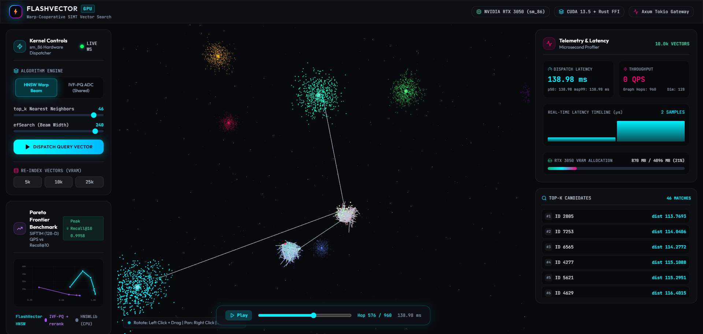
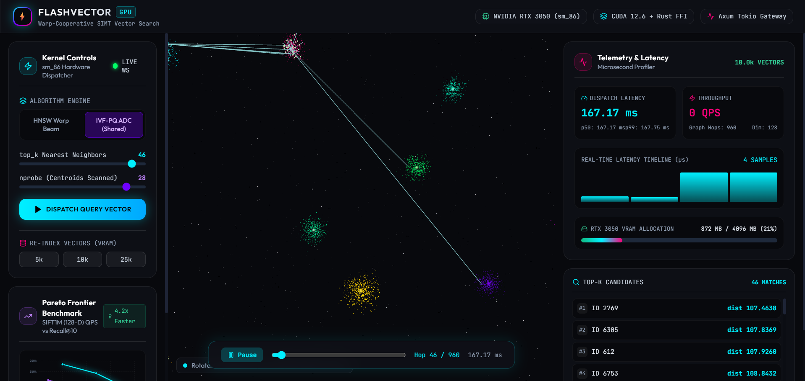

# FlashVector-GPU

**GPU-Accelerated Approximate Nearest Neighbor Search**

*Multi-arch CUDA (`sm_75` / `sm_80` / `sm_86` / `sm_89` / `sm_90`) · SIMT warp-cooperative HNSW · stride-257 shared-memory IVF-PQ ADC · Rust host layer · real-time 3D trajectory visualizer*

---

## Real-Time 3D Visualizer & Trajectory Streamer

FlashVector-GPU includes an interactive Three.js/WebGL visualizer backed by an Axum WebSocket stream. It renders graph traversal hops, Voronoi cluster partitions, top-k targets, and per-query telemetry in real time, with a playback scrubber for hop-by-hop replay and `InstancedMesh` rendering for datasets above 100k points.

### 1. Warp-Cooperative HNSW Graph Beam Search

*Figure 1: Real-time HNSW beam search routing across 10,000 vectors with `efSearch = 112`, tracing animated 3D traversal rays from the entry point to the top-k nearest neighbors.*

### 2. IVF-PQ Dynamic Shared-Memory ADC Lookup

*Figure 2: IVF-PQ asymmetric distance computation scanning probed Voronoi centroids and decompressing quantized vector codes in dynamic shared memory.*

---

## Architectural Overview

FlashVector-GPU is a GPU vector search engine designed for low-latency retrieval over large embedding sets. It combines CUDA SIMT compute primitives with a concurrency-oriented Rust host layer, zero-copy Python/PyTorch bindings, and an interactive WebGL graph visualizer.

```text
                               +--------------------------------------------+
                               |           Client Applications              |
                               |  (Python PyTorch / REST / Web Visualizer)  |
                               +---------------------+----------------------+
                                                     |
                         +---------------------------+---------------------------+
                         |                                                       |
                         v (Direct PyTorch CUDA Ptr / DLPack)                    v (HTTP / WebSocket)
             +-----------------------+                               +-----------------------+
             | PyO3 Python Extension |                               |  Axum / Tokio Server  |
             |   (gpu_vector_index)  |                               | (REST + /ws/stream)   |
             +-----------+-----------+                               +-----------+-----------+
                         |                                                       |
                         +---------------------------+---------------------------+
                                                     |
                                                     v
                               +--------------------------------------------+
                               |          Rust Host Orchestrator            |
                               |    crates/engine (GpuVectorIndex)          |
                               |  - Pre-allocated Device Scratchpads        |
                               |  - Multi-Stream Worker Queue (cudaStream_t)|
                               |  - Malkov-Yashunin HNSW Builder            |
                               +---------------------+----------------------+
                                                     |
                                                     | (Zero-Overhead C FFI Bridge)
                                                     v
                               +--------------------------------------------+
                               |          CUDA SIMT Compute Layer           |
                               |       (multi-arch: sm_75 - sm_90)          |
                               |  +--------------------------------------+  |
                               |  |  Warp-Cooperative HNSW Beam Search   |  |
                               |  |  - __shfl_sync neighbor routing      |  |
                               |  |  - 2048-entry 4-way visited table    |  |
                               |  +--------------------------------------+  |
                               |  |  Asymmetric Distance (ADC) IVF-PQ    |  |
                               |  |  - Dynamic Shared Memory Stride-257  |  |
                               |  |  - 32-way Bank Conflict Elimination  |  |
                               |  |  - Block Bitonic Top-K Candidate Merge |
                               |  +--------------------------------------+  |
                               |  |  Warp Bitonic Top-K Sorting Network  |  |
                               +--------------------------------------------+
```

---

## Mathematical Foundations & Hardware Optimizations

### 1. Warp-Level Vector Distance Reduction

Given query vector $`\mathbf{q} \in \mathbb{R}^D`$ and candidate vector $`\mathbf{x} \in \mathbb{R}^D`$, 32 threads within an NVIDIA warp cooperatively reduce Euclidean squared distance with no global memory barriers:

$$
\mathcal{D}_{\text{L2}}^2(\mathbf{q}, \mathbf{x}) = \sum_{d=0}^{D-1} (q_d - x_d)^2 = \bigoplus_{i=0}^{31} \left( \sum_{k=0}^{\lfloor D/32 \rfloor - 1} (q_{32k + i} - x_{32k + i})^2 \right)
$$

Using warp shuffle intrinsics (`__shfl_down_sync`):

```cpp
__device__ __forceinline__ float warp_reduce_sum(float val) {
    #pragma unroll
    for (int offset = 16; offset > 0; offset /= 2) {
        val += __shfl_down_sync(0xffffffff, val, offset);
    }
    return val;
}
```

### 2. 2,048-Entry Open-Addressing Visited Hash Table

To prevent cycles and avoid global-memory latency during HNSW beam search, each warp maintains a 2,048-entry, 4-way associative hash table with linear probing in shared memory:

```cpp
#define VISITED_HASH_TABLE_SIZE 2048

__device__ __forceinline__ bool insert_visited(uint32_t* table, uint32_t node_id) {
    uint32_t h = (node_id * 2654435761U) & (VISITED_HASH_TABLE_SIZE - 1);
    #pragma unroll
    for (int p = 0; p < 4; ++p) {
        uint32_t idx = (h + p) & (VISITED_HASH_TABLE_SIZE - 1);
        if (table[idx] == node_id) return false;
        if (table[idx] == 0xFFFFFFFFU) {
            table[idx] = node_id;
            return true;
        }
    }
    return true;
}
```

### 3. Bank-Conflict-Free Shared-Memory ADC Lookup (Stride 257)

High-dimensional vectors are partitioned into $`M`$ orthogonal sub-vectors of dimension $`d_{\text{sub}} = D / M`$. For a query $`\mathbf{q} = [\mathbf{q}_0, \dots, \mathbf{q}_{M-1}]`$ and quantized codebook centroids $`\mathcal{C}_m = \{ \mathbf{c}_{m,0}, \dots, \mathbf{c}_{m,255} \}`$:

$$
\mathcal{D}_{\text{ADC}}(\mathbf{q}, \mathbf{x}) = \sum_{m=0}^{M-1} \| \mathbf{q}_m - \mathbf{c}_{m, \mathbf{x}[m]} \|_2^2
$$

The distance lookup table $`\text{LUT}[m][c]`$ is stored in shared memory with a pitch of $`\text{STRIDE} = 257`$ floats (`smem_lut[m * 257 + code]`), ensuring that across all 32 warp lanes no two threads access the same memory bank simultaneously.

### 4. Malkov-Yashunin Diverse Neighbor Selection

Graph construction uses the HNSW diversity heuristic rather than plain k-nearest neighbors. A candidate $`c`$ is accepted only when $`d(c, \text{base}) \le d(c, s)`$ for every neighbor $`s`$ already selected. This retains long-range, low-clustering-coefficient edges that keep greedy beam search from becoming trapped in local neighborhoods.

---

## Benchmark Results (RTX 3050 Laptop, `sm_86`, SIFT1M)

Full SIFT1M (1,000,000 × 128-D), scored against the ann-benchmarks ground truth with 1,000 queries and `k = 10`. FlashVector-GPU was built with `m = 32`, `ef_construction = 128`, `nlist = 256`, `m_pq = 16` on CUDA 13.5; the index build takes 390 s. QPS is the best of five repetitions of a single batched dispatch over all 1,000 queries.

| Engine | Index Type | Recall@10 | QPS (queries/sec) | Mean Latency |
| :--- | :--- | :---: | :---: | :---: |
| **FlashVector-GPU** | **Warp HNSW (`efSearch = 128`)** | **0.9848** | **15,719** | **63.6 µs** |
| **FlashVector-GPU** | **Warp HNSW (`efSearch = 256`)** | **0.9958** | **5,629** | **177.6 µs** |
| **FlashVector-GPU** | **IVF-PQ ADC (`nprobe = 8`)** | **0.5269** | **22,697** | **44.1 µs** |
| **FlashVector-GPU** | **IVF-PQ ADC (`nprobe = 1`)** | **0.3520** | **83,062** | **12.0 µs** |
| HNSWLib | CPU, 12 threads (`efSearch = 64`) | 0.9800 | 13,413 | 74.6 µs |

The full search-parameter sweep for both FlashVector-GPU engines:

| Engine | Search parameter | Recall@10 | QPS | Mean Latency |
| :--- | :--- | :---: | :---: | :---: |
| HNSW | `efSearch = 16` | 0.7568 | 93,686 | 10.7 µs |
| HNSW | `efSearch = 32` | 0.8767 | 51,229 | 19.5 µs |
| HNSW | `efSearch = 64` | 0.9511 | 38,338 | 26.1 µs |
| HNSW | `efSearch = 128` | 0.9848 | 15,719 | 63.6 µs |
| HNSW | `efSearch = 256` | 0.9958 | 5,629 | 177.6 µs |
| IVF-PQ | `nprobe = 1` | 0.3520 | 83,062 | 12.0 µs |
| IVF-PQ | `nprobe = 4` | 0.4960 | 34,657 | 28.9 µs |
| IVF-PQ | `nprobe = 8` | 0.5269 | 22,697 | 44.1 µs |
| IVF-PQ | `nprobe = 16` | 0.5382 | 14,906 | 67.1 µs |
| IVF-PQ | `nprobe = 32` | 0.5422 | 9,522 | 105.0 µs |
| IVF-PQ | `nprobe = 64` | 0.5420 | 5,800 | 172.4 µs |

IVF-PQ throughput scales with the number of probed lists, while recall saturates near 0.54 beyond `nprobe = 16`: at that point the residual error is quantization from the 8-bit, 16-sub-quantizer codebook rather than missing candidates. Widening the codebook raises the ceiling at the cost of memory and build time.

---

## Build & Installation

### Prerequisites

- NVIDIA GPU and driver (`nvidia-smi`)
- CUDA Toolkit 12.6 or newer, or the CUDA compiler/runtime distributed on PyPI
- Rust 1.80+ (`rustup`)
- Node.js 20+ with pnpm or npm
- CMake 3.24+ and a C++17 host compiler

### Linux / WSL2

```bash
git clone https://github.com/flashvector/flashvector-gpu.git
cd flashvector-gpu
make build
```

`make build` compiles the multi-arch CUDA archive and the Rust workspace, then builds the Next.js frontend.

### Windows (native, MSVC)

The Windows build requires the Visual Studio C++ build tools. If the system CUDA toolkit is not installed, the compiler and runtime available from PyPI can be used instead:

```powershell
pip install nvidia-cuda-nvcc nvidia-cuda-runtime nvidia-cuda-crt nvidia-nvvm

$cu = python -c "import nvidia.cuda_nvcc, pathlib; print(pathlib.Path(nvidia.cuda_nvcc.__file__).resolve().parents[1] / 'cu13')"
$env:CUDA_HOME = "$cu"
$env:CUDA_PATH = "$cu"
$env:PATH = "$cu\bin;$cu\bin\x86_64;$env:PATH"
```

Build from an **x64 Native Tools Command Prompt for VS 2022** (or call `vcvars64.bat` first) so that `cl.exe` is visible to `nvcc`:

```bat
cargo build --workspace --release
npm --prefix web install
npm --prefix web run build
```

> `...\nvidia\cu13\bin\x86_64` provides `cudart64_13.dll` at test and runtime.

### Python extension

Run `maturin develop` from an activated virtual environment:

```bash
python -m venv .venv
source .venv/bin/activate        # Windows: .venv\Scripts\activate
pip install maturin
maturin develop --release
# or produce a wheel
maturin build --release
```

---

## Testing

```bash
# Rust workspace, CUDA sanity, and end-to-end recall tests
cargo test --workspace -- --nocapture
cargo test --test cuda_sanity_test -- --nocapture
cargo test --test e2e_search_test -- --nocapture

# Python bindings (NumPy, CPU PyTorch, CUDA PyTorch)
python -m pytest python/tests -v

# Memory/race/synchronization checks (Linux, full CUDA Toolkit)
bash scripts/check_sanitizer.sh
```

The current tree was validated on an NVIDIA RTX 3050 Laptop (`sm_86`) with CUDA 13.5: 4/4 CUDA sanity tests, 2/2 end-to-end tests (Recall@10 = 1.0000 on a 5,000-vector synthetic dataset), 7/7 Python binding tests, and REST snapshot/search plus WebSocket streaming smoke tests. `compute-sanitizer` ships with the full CUDA Toolkit and is not included in the PyPI compiler/runtime packages; on Windows it also requires the WDDM debugger interface to be enabled by running `EnableDebuggerInterface.bat` as Administrator.

---

## Python & PyTorch Usage

CUDA-resident tensors are consumed through their device pointers, so `search()` and `search_ivf()` avoid host round-trips.

```python
import torch
import gpu_vector_index

dataset = torch.randn(50_000, 128, dtype=torch.float32, device="cuda")
query = torch.randn(10, 128, dtype=torch.float32, device="cuda")

index = gpu_vector_index.FlashVectorGPU(
    dim=128, max_elements=50_000, m=32, ef_construction=128
)
index.build(dataset)

labels, distances = index.search(query, top_k=10, ef_search=64)
print(labels.shape)      # (10, 10)
print(distances.shape)   # (10, 10)

ivf_labels, ivf_distances = index.search_ivf(query, top_k=10, nprobe=8)
```

---

## Studio HTTP & WebSocket API

The Axum gateway exposes REST endpoints for index management and a WebSocket stream for query telemetry.

| Method | Path | Description |
| :--- | :--- | :--- |
| `GET` | `/api/v1/stats` | Vector count, dimension, VRAM, and latency statistics |
| `GET` | `/api/v1/vectors/3d` | PCA-projected 3D points and cluster assignments |
| `POST` | `/api/v1/index` | Rebuild the index from generated or supplied vectors |
| `POST` | `/api/v1/snapshot` | Build an index from an uploaded embedding snapshot |
| `POST` | `/api/v1/search` | HNSW or IVF-PQ query with traversal-hop telemetry |
| `GET` | `/api/v1/pq_distortion` | Per-cluster PQ reconstruction error for the heatmap |
| `WS` | `/ws/stream` | Streaming query responses and latency telemetry |

Frontend endpoints are configurable through `NEXT_PUBLIC_API_URL`, `NEXT_PUBLIC_WS_URL`, and `NEXT_PUBLIC_WS_PORT`; the visualizer selects `ws://` or `wss://` from the page protocol automatically.

---

## License

Licensed under the Apache License, Version 2.0. See [LICENSE](LICENSE) for details.
