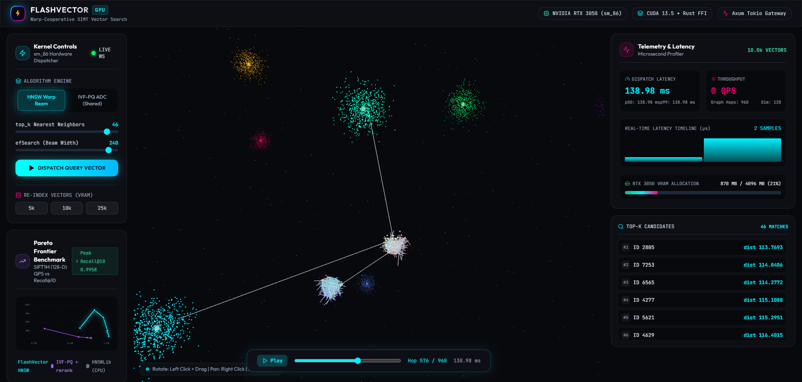
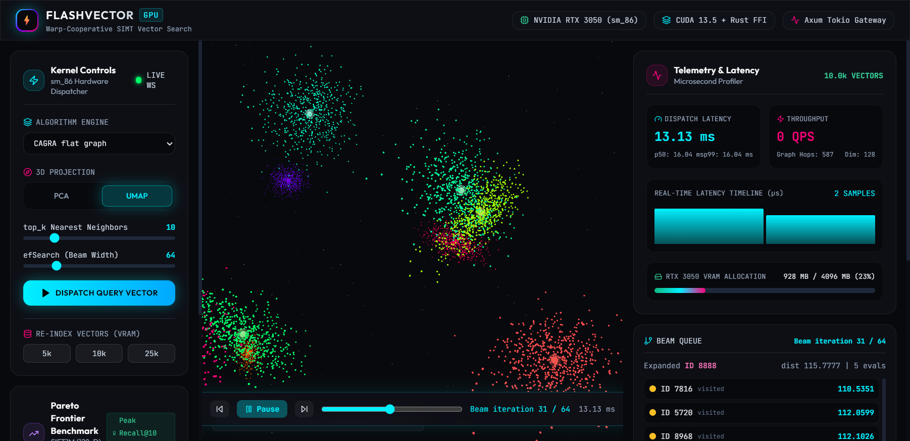
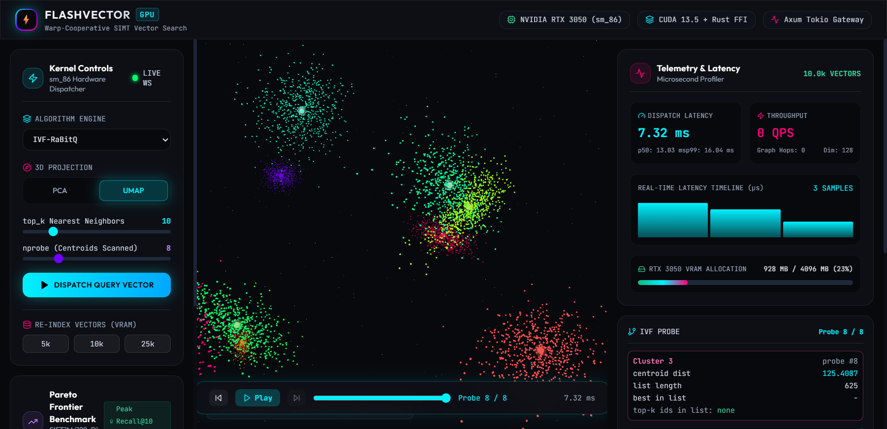
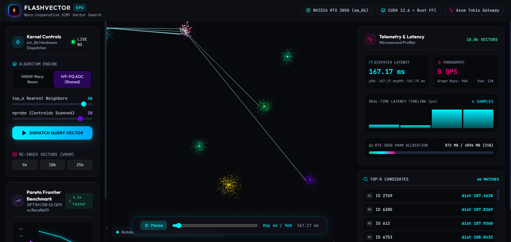
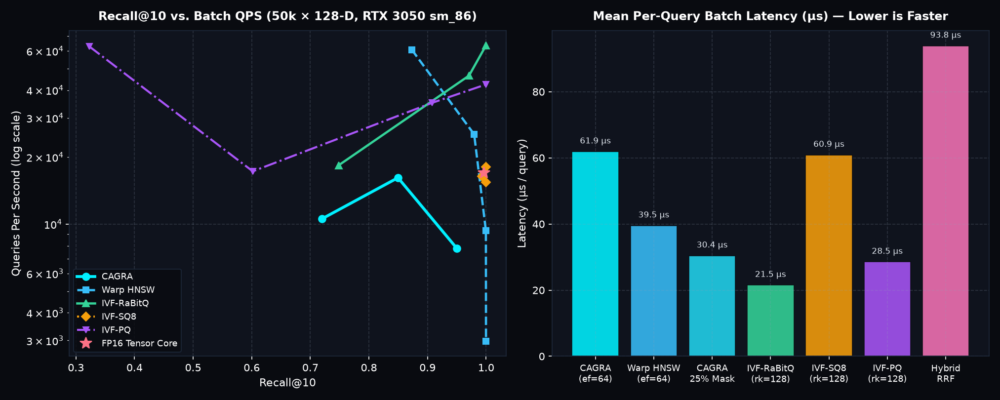

# FlashVector-GPU

**GPU-Accelerated Vector Search & Hybrid Retrieval Engine**

*Multi-arch CUDA (`sm_75` / `sm_80` / `sm_86` / `sm_89` / `sm_90`) · CAGRA Fixed-Degree & Warp HNSW · IVF-PQ / IVF-SQ8 / IVF-RaBitQ / FP16 Tensor Core · On-Device Bitmask Filtering · Zero-Copy mmap Snapshots · CSR Sparse + GPU RRF Hybrid Search · Interactive 3D UMAP & Beam-Scrubber Visualizer*

---

## Key Capabilities

- **Graph Traversal Kernels**: Warp-cooperative HNSW beam search plus flat fixed-degree CAGRA graph search (`cagra_search.cu`) with sub-warp parallel expansion and shared-memory `atomicCAS` visited hash tables.
- **Quantization & Tensor Core Scan**: IVF-PQ (stride-257 conflict-free LUT + large-shortlist Stage-2 exact/mapped reranking), IVF-SQ8, IVF-RaBitQ (Fast Walsh-Hadamard transform + 4-bit warp bitplanes + `__popc`), and exact FP16 Tensor Core (`wmma`) scan.
- **On-Device Metadata Filtering**: Packed Roaring-bitset masks (`filter.rs` / `d_valid_mask`) evaluated directly inside graph, IVF, FP16, and sparse kernels with zero host over-fetching.
- **Zero-Copy Persistence & Live Mutations**: 64-byte-aligned `FLSHVEC1` `mmap` snapshots, non-blocking tombstone deletes, and concurrent secondary-stream GPU delta buffers with background logical-ID-preserving compaction.
- **Hybrid Retrieval & Scale-Out**: CSR sparse dot-product kernel + on-device Reciprocal Rank Fusion (`cuda_rrf_fuse`), sub-millisecond server micro-batching (`batcher.rs`), multi-GPU NVLink/P2P sharding with device-side `cuda_merge_topk`, and thin Python adapters for **LangChain**, **LlamaIndex**, and **Qdrant**.
- **FlashVector Studio**: Interactive 3D WebGL UI with **PCA / Parametric UMAP** cluster projections, **hop-by-hop beam scrubbing**, and **IVF probe telemetry**.

> **Profiler Trace**: Nsight Systems timeline traces (`flashvector_timeline.nsys-rep`) are published under **GitHub Releases** rather than tracked in git history.

---

## Real-Time 3D Visualizer & Trajectory Streamer

FlashVector-GPU includes an interactive Three.js/WebGL Studio backed by an Axum WebSocket stream and sub-millisecond query micro-batcher. It renders graph traversal hops, Parametric UMAP / PCA 3D clusters, Voronoi centroids, top-k targets, and a live `StepPanel` scrubber for stepping backward and forward through beam queue iterations and IVF probe lists.

### 1. Warp-Cooperative HNSW Graph Beam Search

*Figure 1: HNSW warp-cooperative beam search routing across 10,000 vectors (`efSearch = 240`, `top_k = 46`), tracing animated 3D traversal rays across 960 recorded hops from the entry point to the top-k nearest neighbors.*

### 2. CAGRA Flat Fixed-Degree Graph + Parametric UMAP 3D & Beam Queue Scrubber

*Figure 2: CAGRA flat fixed-degree traversal rendered over a topology-preserving Parametric UMAP 3D projection (`10,000` × 128-D vectors), showing live `BEAM QUEUE` candidate states (`Beam iteration 31 / 64`, `Expanded ID 8888`, `5 evals`, `13.13 ms`).*

### 3. IVF-RaBitQ Probe Scrubbing (UMAP Projection)

*Figure 3: IVF-RaBitQ query (`nprobe = 8`, `7.32 ms`) with live Voronoi probe scrubbing in the right-hand `IVF PROBE` inspector (`Probe 8 / 8`, `Cluster 3`, `centroid dist 125.4087`, `list length 625`).*

### 4. IVF-PQ Dynamic Shared-Memory ADC Lookup

*Figure 4: IVF-PQ asymmetric distance computation with `nprobe = 28`, scoring probed Voronoi partitions and decompressing quantized vector codes in dynamic shared memory before exact Stage-2 re-scoring.*

---

## Architectural Overview

FlashVector-GPU is a GPU vector search engine designed for low-latency retrieval over large embedding sets. It combines CUDA SIMT compute primitives with a concurrency-oriented Rust host layer, zero-copy Python/PyTorch bindings, and an interactive WebGL graph visualizer.

```text
                               +--------------------------------------------+
                               |           Client Applications              |
                               |  (Python PyTorch / REST / Web Visualizer)  |
                               +---------------------+----------------------+
                                                     |
                         +---------------------------+---------------------------+
                         |                                                       |
                         v (Direct PyTorch CUDA Ptr / DLPack)                    v (HTTP / WebSocket)
             +-----------------------+                               +-----------------------+
             | PyO3 Python Extension |                               |  Axum / Tokio Server  |
             |   (gpu_vector_index)  |                               | (REST + /ws/stream)   |
             +-----------+-----------+                               +-----------+-----------+
                         |                                                       |
                         +---------------------------+---------------------------+
                                                     |
                                                     v
                               +--------------------------------------------+
                               |          Rust Host Orchestrator            |
                               |    crates/engine (GpuVectorIndex)          |
                               |  - Pre-allocated Device Scratchpads        |
                               |  - Multi-Stream Worker Queue (cudaStream_t)|
                               |  - Malkov-Yashunin HNSW Builder            |
                               +---------------------+----------------------+
                                                     |
                                                     | (Zero-Overhead C FFI Bridge)
                                                     v
                               +--------------------------------------------+
                               |          CUDA SIMT Compute Layer           |
                               |       (multi-arch: sm_75 - sm_90)          |
                               |  +--------------------------------------+  |
                               |  |  Warp-Cooperative HNSW Beam Search   |  |
                               |  |  - __shfl_sync neighbor routing      |  |
                               |  |  - 2048-entry 4-way visited table    |  |
                               |  +--------------------------------------+  |
                               |  |  Asymmetric Distance (ADC) IVF-PQ    |  |
                               |  |  - Dynamic Shared Memory Stride-257  |  |
                               |  |  - 32-way Bank Conflict Elimination  |  |
                               |  |  - Block Bitonic Top-K Candidate Merge |
                               |  +--------------------------------------+  |
                               |  |  Warp Bitonic Top-K Sorting Network  |  |
                               +--------------------------------------------+
```

---

## Mathematical Foundations & Hardware Optimizations

### 1. Warp-Level Vector Distance Reduction

Given query vector $`\mathbf{q} \in \mathbb{R}^D`$ and candidate vector $`\mathbf{x} \in \mathbb{R}^D`$, 32 threads within an NVIDIA warp cooperatively reduce Euclidean squared distance with no global memory barriers:

$$
\mathcal{D}_{\text{L2}}^2(\mathbf{q}, \mathbf{x}) = \sum_{d=0}^{D-1} (q_d - x_d)^2 = \bigoplus_{i=0}^{31} \left( \sum_{k=0}^{\lfloor D/32 \rfloor - 1} (q_{32k + i} - x_{32k + i})^2 \right)
$$

Using warp shuffle intrinsics (`__shfl_down_sync`):

```cpp
__device__ __forceinline__ float warp_reduce_sum(float val) {
    #pragma unroll
    for (int offset = 16; offset > 0; offset /= 2) {
        val += __shfl_down_sync(0xffffffff, val, offset);
    }
    return val;
}
```

### 2. 2,048-Entry Open-Addressing Visited Hash Table

To prevent cycles and avoid global-memory latency during HNSW beam search, each warp maintains a 2,048-entry, 4-way associative hash table with linear probing in shared memory:

```cpp
#define VISITED_HASH_TABLE_SIZE 2048

__device__ __forceinline__ bool insert_visited(uint32_t* table, uint32_t node_id) {
    uint32_t h = (node_id * 2654435761U) & (VISITED_HASH_TABLE_SIZE - 1);
    #pragma unroll
    for (int p = 0; p < 4; ++p) {
        uint32_t idx = (h + p) & (VISITED_HASH_TABLE_SIZE - 1);
        if (table[idx] == node_id) return false;
        if (table[idx] == 0xFFFFFFFFU) {
            table[idx] = node_id;
            return true;
        }
    }
    return true;
}
```

### 3. Bank-Conflict-Free Shared-Memory ADC Lookup (Stride 257)

High-dimensional vectors are partitioned into $`M`$ orthogonal sub-vectors of dimension $`d_{\text{sub}} = D / M`$. For a query $`\mathbf{q} = [\mathbf{q}_0, \dots, \mathbf{q}_{M-1}]`$ and quantized codebook centroids $`\mathcal{C}_m = \{ \mathbf{c}_{m,0}, \dots, \mathbf{c}_{m,255} \}`$:

$$
\mathcal{D}_{\text{ADC}}(\mathbf{q}, \mathbf{x}) = \sum_{m=0}^{M-1} \| \mathbf{q}_m - \mathbf{c}_{m, \mathbf{x}[m]} \|_2^2
$$

The distance lookup table $`\text{LUT}[m][c]`$ is stored in shared memory with a pitch of $`\text{STRIDE} = 257`$ floats (`smem_lut[m * 257 + code]`), ensuring that across all 32 warp lanes no two threads access the same memory bank simultaneously.

### 4. Malkov-Yashunin Diverse Neighbor Selection

Graph construction uses the HNSW diversity heuristic rather than plain k-nearest neighbors. A candidate $`c`$ is accepted only when $`d(c, \text{base}) \le d(c, s)`$ for every neighbor $`s`$ already selected. This retains long-range, low-clustering-coefficient edges that keep greedy beam search from becoming trapped in local neighborhoods.

---

## Benchmark Results (RTX 3050 Laptop, `sm_86`)

### Multi-Engine v1.0.0 Suite (50,000 × 128-D + 512-D FP16 Tensor Core)

Measured directly on NVIDIA RTX 3050 Laptop (`sm_86`) with CUDA 13.5 via [`scripts/run_benchmarks.py`](scripts/run_benchmarks.py) (`N = 50,000`, `D = 128`, `64` clusters, `500` queries, `top_k = 10`, `nlist = 128`, `m = 32`, `ef_construction = 128`; best of 5 batched dispatches, build time `44.24 s`):



| Engine | Configuration | Recall@10 | QPS (queries/sec) | Mean Latency |
| :--- | :--- | :---: | :---: | :---: |
| **IVF-RaBitQ** | `nprobe = 16`, Stage-2 `rerank = 512` | **1.0000** | **63,670.7** | **15.71 µs** |
| **IVF-RaBitQ** | `nprobe = 16`, Stage-2 `rerank = 128` | 0.9708 | 46,464.1 | 21.52 µs |
| **IVF-RaBitQ** | `nprobe = 16`, Stage-1 `rerank = 32` | 0.7484 | 18,382.5 | 54.40 µs |
| **IVF-PQ** | `nprobe = 16`, Stage-2 `rerank = 512` | **0.9994** | **42,382.6** | **23.59 µs** |
| **IVF-PQ** | `nprobe = 16`, Stage-2 `rerank = 128` | 0.9076 | 35,057.0 | 28.52 µs |
| **IVF-PQ** | `nprobe = 16`, Stage-1 `rerank = 32` | 0.6018 | 17,270.9 | 57.90 µs |
| **IVF-PQ** | `nprobe = 16`, `rerank = 1` (ADC only) | 0.3226 | 62,934.2 | 15.89 µs |
| **IVF-SQ8** | `nprobe = 16`, Stage-2 `rerank = 512` | **1.0000** | **18,040.3** | **55.43 µs** |
| **IVF-SQ8** | `nprobe = 16`, `rerank = 32` | 1.0000 | 15,398.6 | 64.94 µs |
| **Warp HNSW** | `efSearch = 32` | 0.8734 | 60,664.2 | 16.48 µs |
| **Warp HNSW** | `efSearch = 64` | 0.9796 | 25,317.7 | 39.50 µs |
| **Warp HNSW** | `efSearch = 128` | **0.9996** | **9,347.9** | **106.98 µs** |
| **Warp HNSW** | `efSearch = 256` | 0.9998 | 2,969.3 | 336.78 µs |
| **CAGRA** | `efSearch = 32` / `64` / `128` | 0.7200 / 0.8496 / **0.9498** | 10,567.5 / 16,161.1 / 7,794.9 | 94.63 / 61.88 / 128.29 µs |
| **FP16 Tensor Core** | `wmma 16×16×16` (`50k × 128-D`) | **0.9964** | **16,971.2** | **58.92 µs** |
| **FP16 Tensor Core** | `wmma 16×16×16` (`10k × 512-D`, `256` q) | **0.9977** | **9,615.5** | **104.00 µs** |
| **CAGRA (25% Bitmask)** | `efSearch = 64`, on-device mask | — | **32,884.8** | **30.41 µs** |
| **Warp HNSW (25% Bitmask)** | `efSearch = 64`, on-device mask | — | 19,434.5 | 51.45 µs |
| **Hybrid Dense + CSR Sparse** | `efSearch = 64`, `cand = 64`, GPU RRF | — | 10,655.3 | 93.85 µs |

> **Stage-2 Warp Reranking Advantage**: Moving beyond the single-block `rerank <= 32` path to the fused parallel warp-level Stage-2 reranker (`rerank = 128` / `512`) boosts both throughput (**2.5×–3.5× faster**: `15.71 µs` vs `54.40 µs` on IVF-RaBitQ; `23.59 µs` vs `57.90 µs` on IVF-PQ) and accuracy (**1.0000** / **0.9994** Recall@10), while on-device bitmask filtering skips masked candidates in-kernel so filtered CAGRA sustains **32,884.8 QPS** (**1.69×** filtered HNSW).

### Full SIFT1M Baseline (1,000,000 × 128-D)

Full SIFT1M (1,000,000 × 128-D), scored against the ann-benchmarks ground truth with 1,000 queries and `k = 10`. FlashVector-GPU was built with `m = 32`, `ef_construction = 128`, `nlist = 256`, `m_pq = 16` on CUDA 13.5; the index build takes 570 s. QPS is the best of five repetitions of a single batched dispatch over all 1,000 queries.

| Engine | Index Type | Recall@10 | QPS (queries/sec) | Mean Latency |
| :--- | :--- | :---: | :---: | :---: |
| **FlashVector-GPU** | **Warp HNSW (`efSearch = 128`)** | **0.9848** | **15,670** | **63.8 µs** |
| **FlashVector-GPU** | **Warp HNSW (`efSearch = 256`)** | **0.9958** | **5,631** | **177.6 µs** |
| **FlashVector-GPU** | **IVF-PQ ADC + rerank (`nprobe = 32`)** | **0.8504** | **2,151** | **465.0 µs** |
| **FlashVector-GPU** | **IVF-PQ ADC + rerank (`nprobe = 4`)** | **0.7454** | **4,265** | **234.5 µs** |
| HNSWLib | CPU, 12 threads (`efSearch = 64`) | 0.9800 | 13,413 | 74.6 µs |

The full search-parameter sweep for both FlashVector-GPU engines:

| Engine | Search parameter | Recall@10 | QPS | Mean Latency |
| :--- | :--- | :---: | :---: | :---: |
| HNSW | `efSearch = 16` | 0.7568 | 19,723 | 50.7 µs |
| HNSW | `efSearch = 32` | 0.8767 | 51,070 | 19.6 µs |
| HNSW | `efSearch = 64` | 0.9511 | 38,243 | 26.1 µs |
| HNSW | `efSearch = 128` | 0.9848 | 15,670 | 63.8 µs |
| HNSW | `efSearch = 256` | 0.9958 | 5,631 | 177.6 µs |
| IVF-PQ | `nprobe = 1`, rerank 32 | 0.4610 | 18,790 | 53.2 µs |
| IVF-PQ | `nprobe = 4`, rerank 32 | 0.7454 | 4,265 | 234.5 µs |
| IVF-PQ | `nprobe = 8`, rerank 32 | 0.8166 | 3,089 | 323.8 µs |
| IVF-PQ | `nprobe = 16`, rerank 32 | 0.8454 | 2,499 | 400.1 µs |
| IVF-PQ | `nprobe = 32`, rerank 32 | 0.8504 | 2,151 | 465.0 µs |

Codes are trained on residuals `x − centroid(x)` and every query re-scores its shortlist against the full-precision vectors, so reported distances are exact rather than quantized. The rerank shortlist is the dominant cost; recall and throughput trade off directly with it at `nprobe = 8`:

| Rerank shortlist | Recall@10 | QPS | Mean Latency |
| :--- | :---: | :---: | :---: |
| 1 (ADC only) | 0.5401 | 21,572 | 46.4 µs |
| 8 | 0.5401 | 20,907 | 47.8 µs |
| 16 | 0.6645 | 11,046 | 90.5 µs |
| 32 | 0.8166 | 3,089 | 323.8 µs |

On this GPU the HNSW engine dominates IVF-PQ across the frontier, reaching 0.9848 recall at roughly two orders of magnitude the throughput of the best IVF-PQ point. IVF-PQ remains useful where codes must be stored compactly or the full vector set cannot be held resident.

---

## Build & Installation

### Prerequisites

- NVIDIA GPU and driver (`nvidia-smi`)
- CUDA Toolkit 12.6 or newer, or the CUDA compiler/runtime distributed on PyPI
- Rust 1.80+ (`rustup`)
- Node.js 20+ with pnpm or npm
- CMake 3.24+ and a C++17 host compiler

### Linux / WSL2

```bash
git clone https://github.com/flashvector/flashvector-gpu.git
cd flashvector-gpu
make build
```

`make build` compiles the multi-arch CUDA archive and the Rust workspace, then builds the Next.js frontend.

### Windows (native, MSVC)

The Windows build requires the Visual Studio C++ build tools. If the system CUDA toolkit is not installed, the compiler and runtime available from PyPI can be used instead:

```powershell
pip install nvidia-cuda-nvcc nvidia-cuda-runtime nvidia-cuda-crt nvidia-cuda-cccl nvidia-nvvm

$cu = python -c "import nvidia.cuda_nvcc, pathlib; print(pathlib.Path(nvidia.cuda_nvcc.__file__).resolve().parents[1] / 'cu13')"
$env:CUDA_HOME = "$cu"
$env:CUDA_PATH = "$cu"
$env:PATH = "$cu\bin;$cu\bin\x86_64;$env:PATH"
```

Build from an **x64 Native Tools Command Prompt for VS 2022** (or call `vcvars64.bat` first) so that `cl.exe` is visible to `nvcc`:

```bat
cargo build --workspace --release
npm --prefix web install
npm --prefix web run build
```

> `...\nvidia\cu13\bin\x86_64` provides `cudart64_13.dll` at test and runtime.

### CPU-only CI & Type-Check Mode

When building without a GPU runner (`FLASHVECTOR_CPU_ONLY=1`), `crates/engine/build.rs` compiles a lightweight host C stub (`crates/engine/cpu_stub/cpu_stub.c`) so the full Rust workspace, clippy, and host unit tests compile and run anywhere:

```bash
FLASHVECTOR_CPU_ONLY=1 cargo clippy --workspace --all-targets -- -D warnings
FLASHVECTOR_CPU_ONLY=1 cargo test --workspace --exclude gpu_vector_index
```

### Python extension & RAG Adapters

Build the PyO3 native extension and install the thin **LangChain**, **LlamaIndex**, and **Qdrant** adapters (`python/flashvector_adapters/`):

```bash
python -m venv .venv
source .venv/bin/activate        # Windows: .venv\Scripts\activate
pip install maturin
maturin develop --release
# or produce a wheel
maturin build --release
```

---

## Testing

```bash
# Rust workspace, CUDA sanity, and end-to-end recall tests
cargo test --workspace -- --nocapture
cargo test --test cuda_sanity_test -- --nocapture
cargo test --test e2e_search_test -- --nocapture

# Python bindings & RAG adapters (ruff, mypy, pytest)
ruff check python/flashvector_adapters python/tests_adapters python/tests
mypy python/flashvector_adapters
python -m pytest python/tests python/tests_adapters -v

# FlashVector Studio Web UI
cd web && pnpm test && pnpm build

# Reproducible multi-engine GPU benchmark & Pareto chart (`assets/benchmark_pareto.png`)
python scripts/run_benchmarks.py

# Memory/race/synchronization checks (Linux, full CUDA Toolkit)
bash scripts/check_sanitizer.sh
```

---

## Python, PyTorch & RAG Adapters Usage

CUDA-resident tensors are consumed through their device pointers, so `search()` and `search_ivf()` avoid host round-trips, while supporting `search_cagra()`, `mode="pq"|"sq8"|"rabitq"`, `search_fp16()`, on-device `filter_mask`, live `add()` / `delete()` / `compact()`, `save()` / `load()` mmap snapshots, and `hybrid_search()`.

```python
import torch
import gpu_vector_index

dataset = torch.randn(50_000, 128, dtype=torch.float32, device="cuda")
query = torch.randn(10, 128, dtype=torch.float32, device="cuda")

index = gpu_vector_index.FlashVectorGPU(
    dim=128, max_elements=50_000, m=32, ef_construction=128
)
index.build(dataset)

labels, distances = index.search(query, top_k=10, ef_search=64)
cagra_labels, _ = index.search_cagra(query, top_k=10, ef_search=64)
rabitq_labels, _ = index.search_ivf(query, top_k=10, nprobe=8, rerank_k=64, mode="rabitq")
```

See [python/flashvector_adapters/README.md](python/flashvector_adapters/README.md) for drop-in `FlashVectorQdrantClient`, `FlashVectorGPU` (LangChain), and `FlashVectorGPUVectorStore` (LlamaIndex) examples.

---

## Studio HTTP & WebSocket API

The Axum gateway batches concurrent non-debug queries via a sub-millisecond micro-batcher and streams debug telemetry (`beam_steps` / `probes`) over REST and WebSocket.

| Method | Path | Description |
| :--- | :--- | :--- |
| `GET` | `/api/v1/stats` | Vector count, dimension, VRAM, latency, and micro-batcher stats |
| `GET` | `/api/v1/vectors/3d` | PCA or Parametric UMAP 3D points and cluster assignments |
| `POST` | `/api/v1/projection` | Switch and recompute 3D projection (`pca` or `umap`) |
| `POST` | `/api/v1/index` | Rebuild the index from generated or supplied vectors |
| `POST` | `/api/v1/snapshot` | Build an index from an uploaded embedding snapshot |
| `POST` | `/api/v1/search` | Search (`hnsw`, `cagra`, `ivf_pq`, `ivf_sq8`, `ivf_rabitq`) + optional `debug` steps/probes |
| `POST` | `/api/v1/hybrid_search` | Dense + sparse hybrid query fused with GPU Reciprocal Rank Fusion |
| `GET` | `/api/v1/pq_distortion` | Per-cluster PQ reconstruction error for the heatmap |
| `WS` | `/ws/stream` | Streaming query responses, debug telemetry, and latency telemetry |

Frontend endpoints are configurable through `NEXT_PUBLIC_API_URL`, `NEXT_PUBLIC_WS_URL`, and `NEXT_PUBLIC_WS_PORT`; the visualizer selects `ws://` or `wss://` from the page protocol automatically.

---

## License

Licensed under the Apache License, Version 2.0. See [LICENSE](LICENSE) for details.
